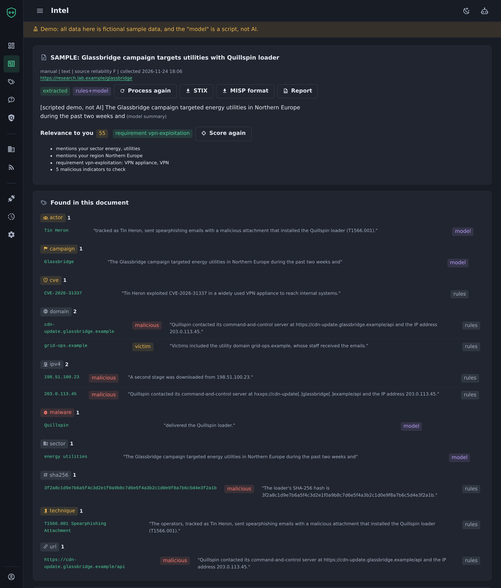
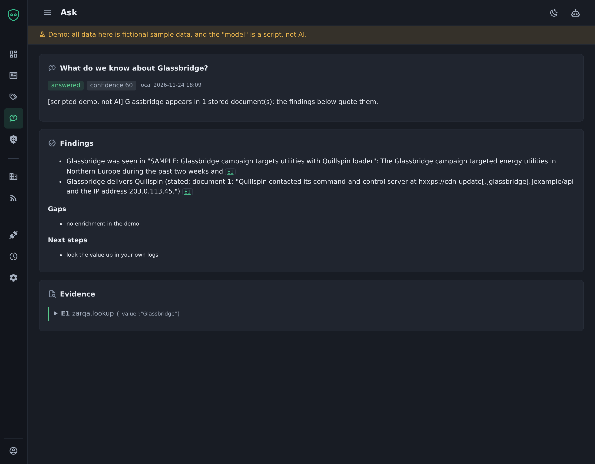
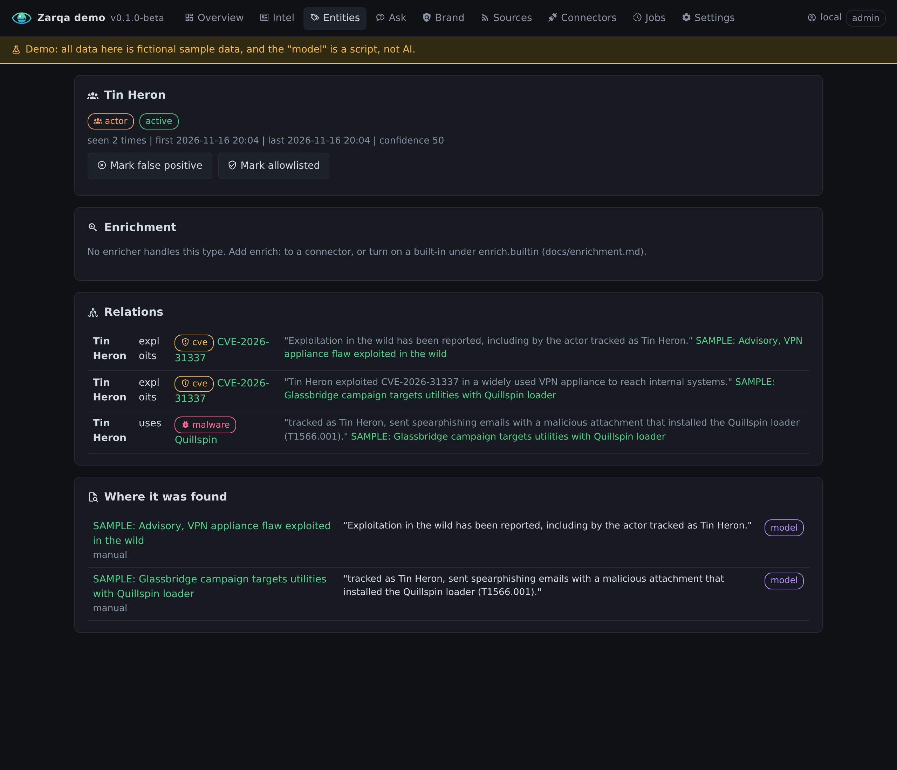
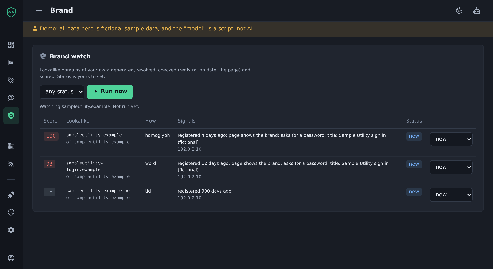

<p align="center"></p>

# Zarqa

[](https://github.com/ares-369/zarqa/actions/workflows/ci.yml)
[](LICENSE)
[](pyproject.toml)
[](https://pypi.org/project/zarqa/)
[](https://github.com/ares-369/zarqa/releases)

**An open-source, AI-powered threat intelligence tool.** Zarqa collects intel from the internet and
from the threat intel platforms you already use, turns it into structured, sourced intel, ranks it by
how much it matters to your organization, and answers questions about it with cited evidence.

It is not a replacement for anything. It works next to your existing platforms, reads from them, and
can send what it finds back to them in standard formats.

Named after Zarqa al-Yamama, who in Arabian legend could see an army coming days before it arrived.

> **Beta, solo-maintained.** Collection, extraction, enrichment, relevance ranking,
> investigations, brand watch, sharing, reports and the connector layer work and are tested. First
> benchmark: [benchmarks](docs/benchmarks.md) (without a model it is precise but misses most names and
> techniques; a small local model doubles name recall at some cost in precision, and adds little to techniques). See the
> [roadmap](docs/roadmap.md).

## What works today

- **Starts collecting on its own.** About 30 well-known public sources (government advisories, research teams,
  security news, known-exploited CVEs, botnet C2 lists) are on by default; turn them all off, or single ones.
- **Collect from the internet and from other platforms.** RSS/Atom feeds (with the full article), pages,
  PDFs, indicator lists (text, CSV, JSON, STIX), and pulls from other intel platforms through MCP
  connectors or the built-in STIX/TAXII 2.1 and REST bridges. On a schedule, or by hand.
  ([collection](docs/collection.md))
- **Turn text into structured intel you can check.** Indicators (defanged or not), CVEs, ATT&CK techniques,
  threat actors, malware, tools, campaigns and targets, and the relations between them. Each one links to
  the sentence it came from and says how it was found. ([extraction](docs/extraction.md))
- **Models are checked, not trusted.** The extractor model must quote the document for every item; items
  whose quote is not in the text are dropped, and a model can label indicators but never add one. Rules
  and ATT&CK names work with no model at all.
- **Aliases resolved.** "Fancy Bear", "Sednit" and "Forest Blizzard" are one actor (APT28), from MITRE
  ATT&CK data shipped with Zarqa.
- **Ranked for you, and filtered to you.** Describe your organization and your intelligence requirements on the
  Profile page; the Intel page then shows only what is relevant to you by default. Every report gets a
  0-100 score with the reasons (your products named, your sector targeted, known-exploited CVEs, a
  requirement answered). ([relevance](docs/relevance.md))
- **Ask, and get a cited answer.** "What do we know about this IP?" The analyst model searches the store and
  your connectors; every finding cites its evidence, unsupported claims are set aside, and "not enough data"
  is an allowed answer. ([investigations](docs/investigations.md))
- **Brand watch.** Lookalikes of your domains, resolved and checked: how new they are, whether the page uses
  your name or asks for a password, or is parked. Scored and tracked with a status. ([brand](docs/brand.md))
- **Confidence apart from relevance.** Each entity gets an Admiralty rating (how reliable its sources are, how
  many independent ones agree, whether they disagree) and a confidence number, so a relevant but thinly supported
  item does not look confirmed. ([confidence](docs/confidence.md))
- **Enrichment on request.** Connectors declare their lookups; built-in EPSS and RDAP are opt-in and never
  sent your own or internal values. ([enrichment](docs/enrichment.md))
- **Shares in standard formats.** STIX 2.1 and MISP-format exports, a read-only TAXII 2.1 server, pushes to
  other platforms that a person starts, and an MCP server so other agents can ask Zarqa.
  ([sharing](docs/sharing.md))
- **A brief.** What came in over a day or a week, most relevant first, with new names, indicators,
  known-exploited CVEs, lookalikes and investigations; Markdown or HTML. `zarqa brief`.
- **Connectors, read-only by default.** Writes to another platform go only through a sharing connector
  with the exact tool allowed, never from a model, always audited. ([connectors](docs/connectors.md))
- **Any model.** Local models through Ollama, or cloud providers, per role. Prompts to cloud models are
  masked (emails, private IPs, user names and your own terms).

## Screenshots

From the offline demo (fictional data).

| A report: what was found, with the sentence each came from | An investigation: every finding cites its evidence |
|---|---|
|  |  |
| **An actor: where it was seen, relations, what ATT&CK knows** | **Brand watch: lookalikes scored and tracked** |
|  |  |

## Planned

A benchmark with a stronger model; registrant comparison in the brand watch; separate worker processes.

## Try it

Offline, with fictional sample data and no model: `zarqa demo --run`, then
`ZARQA_HOME=~/.zarqa-demo zarqa serve` ([demo](docs/demo.md)). Or `docker compose --profile demo up demo`.

```bash
pipx install zarqa               # or: pip install zarqa   (extras: zarqa[all])
zarqa init                       # config.yaml, .env (mode 600) and data/ in the home folder
zarqa doctor                     # checks the setup and says what to fix
zarqa serve                      # http://127.0.0.1:8621

zarqa add --url https://...      # a report, extracted straight away
zarqa sources pull               # pull every source in config.yaml now
zarqa lookup 203.0.113.66        # everything known about a value, with the sentences
zarqa ask "What do we know about 203.0.113.66?"
```

Docker: `docker compose up -d` (non-root, read-only container, loopback port).

## Configuration

`config.example.yaml` documents every setting. Secrets go in `.env` only. Login modes: none
(loopback only), basic, local, OIDC and reverse-proxy headers, with viewer, operator and admin roles.
The server refuses to listen on a network address without a login.

## Project

- Licence: Apache-2.0. No paid edition.
- [SECURITY.md](SECURITY.md) for reporting vulnerabilities.
- [CONTRIBUTING.md](CONTRIBUTING.md) for running the tests.
- [docs/project-standard.md](docs/project-standard.md): the rules this project shares with its sibling
  projects.
